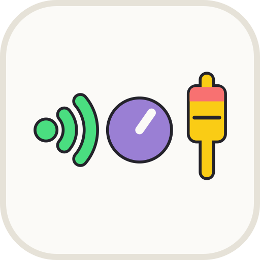

<p align="center">
  <picture>
    <source media="(prefers-color-scheme: dark)" srcset="docs/brand/icon-dark.svg">
    
  </picture>
</p>

<h1 align="center">Learn Signal Chain</h1>

<p align="center"><b>From microphone to speaker.</b> A free web app for teachers and students to build an audio signal chain and watch the level at every step.</p>

An interactive, free, open-source web app for teachers and students to explore and understand audio signal chains — from microphone to speaker. Built for people who have never touched a mixing desk.

## Try It Online

No installation needed:

**[https://msvdm.github.io/Learn_Signal-Chain/](https://msvdm.github.io/Learn_Signal-Chain/)**

Runs entirely in your browser. No account, no backend, no cost.

## Use It Offline

- **Download it:** File → *Download the app…* saves the whole app as one `.html` file. Double-click it and it opens in your web browser — no internet, nothing to install. Put it on a USB stick or a shared drive for a class.
- **Or just visit once:** after your first visit, your browser keeps a copy, so the link above opens without internet too. Most browsers also offer to install it as an app (an icon on your desktop or home screen).

## What is it?

Learn Signal Chain lets you drag and connect audio elements on a canvas and watch the signal flow in real time. Every element you add or adjust changes the signal path immediately, and the meters show whether your gain staging is healthy (green), hot (yellow), or clipping (red).

Build chains like:

**Voice → Microphone → Preamp → EQ → Compressor → Fader → Master Bus → Speaker**

The app does not explain what each element is — that is the teacher's part. It shows what the chain does, as truthfully as it can. Click **?** next to the language button for a short tutorial on how the app works, with example chains to open.

## What's New in 2.1

- **A tutorial for teachers and students.** The **?** button next to the language button opens it: how to build and wire a chain, the three levels, what the meters, colours and wires show, saving and sharing — and eight example chains to open and change: a singer on two speakers, a band on stage, recording a voice, a vocal channel, a monitor mix, a guitar with a DI box, a voice through the converters and a live stream.
- **The app no longer explains the elements.** *What is this?* and its help texts are gone: a paragraph about a microphone or a compressor always leaves something out, and can mislead a beginner. What each element is, the teacher explains; the app shows what the chain does.

- **Each kind of connection looks different.** Sound travelling through the air, from a singer, a drum kit, an acoustic instrument or a guitar amp into a microphone, is drawn as waves spreading from the middle of its card straight to the microphone, with no line, coloured by its level like every connection. A digital connection (after a converter, or a USB cable) is square dots and dashes, like Morse code, with sharp corners; a stereo one is two such rows. An analog cable is one unbroken line, with soft swells of light travelling along it the way the sound goes; a stereo one is two such lines.
- **The inputs, renamed.** The Acoustic Guitar is now the **Acoustic Instrument**, drawn as a trumpet, and is there at Beginner too. The Instrument (an electric guitar or bass, to plug into a DI box or a guitar amp) is now the **Hi-Z Instrument**. The Vocal's picture is a head alone: the waves are the connection's.
- **The Guitar Amp has a DI Out.** Besides its sound in the air, it sends the guitar to the desk at mic level, for a Preamp, the same however loud the amp plays. A Ground Lift switch under its Volume knob: until it is on, the DI Out picks up a hum, as on real amps. And its Volume knob now turns like a real amp's: quiet low down, silent at 0.
- **The two amps are pictures you play.** The Guitar Amp is a small combo with its knob, its power switch and the DI Out on its top panel, and its meter under it. The Amplifier is a rack amp with two channels, A and B, each with its own knob and a meter in the panel: a mono wire plays on the channel it goes into (A out of L, B out of R); one stereo wire goes into both, drawn splitting just before them. Both switch on and off, at Beginner too — switched off, nothing comes out, not even hiss.
- **The speakers and the Headphones lose their box.** Just the speaker or the headphones (an Active Speaker with its Volume knob in front of it, where the sound comes in), their name, and a meter of how loud they play under them, with its Peak, RMS and Noise numbers; what is wrong is still said under the picture. Selected, the picture itself lights up.
- **The instruments lose their box too.** From Intermediate the Drum Kit, the Acoustic Instrument, the Hi-Z Instrument and the Keyboard look like the speakers: the instrument, its name and a meter under it with its Peak, RMS and Noise, the same however far you zoom. The Computer keeps its upright meter beside the laptop, with no box, at every zoom — and so does Stream / Broadcast, its meter beside the tower.
- **A port for every connection into a bus.** A Master, Aux, Matrix or PFL Bus (and the Mixer, the Stage Box, the Audio Interface and the DAW) shows one input for each wire plugged in and an empty one under them for the next, up to 8. To unplug one, click its input: the list of connections is gone.
- **No more chain colours.** The coloured stripes that tagged each source are gone.
- **Wires show the health of their signal.** From Intermediate on, a connection has the meters' colours: blue too quiet, green good, yellow hot, red clipping, grey with no signal — on every chain, whatever bus it goes to. The colours by bus (green Master, blue Aux …) are gone.
- **A new logo.** A sound wave, a knob and a fader: the signal chain in three steps — the sound arrives, a hand sets its level, and it leaves through a fader.

## What's New in 2.0

- **Each level is a different scale.** *Beginner* shows the devices in a room — a singer, a drum kit, microphones, a keyboard, a computer, a stage box, a mixer, speakers — and how they are wired. No numbers: every speaker, recorder or stream simply says whether sound reaches it. *Intermediate* opens up the channel strip of a small mixing desk (modelled on the Yamaha MG12XU). *Advanced* shows the parts and the digital side.
- **The microphone is not the sound.** A Vocal (Speech or Singing), a Drum Kit, an Acoustic Guitar or a Guitar Amp makes sound in the air, with a meter of how loud it is (dB SPL). A dotted wire carries that sound to a Microphone, which turns it into a signal. One drum kit can feed several microphones.
- **Dynamic or condenser microphone.** A condenser gives about 12 dB more signal from the same sound, but hears the room louder too — and stays silent until you put Phantom Power (48V) before its Preamp and switch it on.
- **A real desk's channel strip** at Intermediate: 48V, Preamp, an 80 Hz high-pass button, a three-knob equalizer and a one-knob compressor (as on the Yamaha MG), each a bare control as on the desk. The full cards wait at Advanced.
- **New sources and outputs:** Keyboard (stereo — it replaces the Line Input), Computer, Studio Monitor, Recorder, Stream / Broadcast. An Amplifier's output now goes only into a passive speaker, and a passive speaker without one says why it is silent.
- **Record and play back.** An Audio Interface and a DAW (a recording program on a computer): one USB wire carries your mix into the computer and the computer's song back out, into the desk or the monitors. At Beginner a microphone or a guitar plugs straight into the Interface. *Look inside* shows what the boxes hold: the same channel strip, as numbers.
- **The digital picture** at Advanced: a Decoder plays a song that is digital from the start, its peaks at −18 dBFS (the EBU level); an Encoder packs the mix into MP3, AAC or Opus for a Stream / Broadcast; the DAW adds up the digital signals it records, like a mixing bus, and plays them into a Recorder Track, which shows an analog signal on a VU meter's needle.
- **Flip it.** Right-click a Gain or an On Off Switch to flip it horizontally (the sound flows right to left) or vertically (on its side: a PFL button standing under its channel). Flip an Active Speaker and it becomes a stage monitor facing the band; Headphones turn to face the other way too.
- **Drop a card anywhere on a wire** and it goes into it — a wire turning down to a PFL Bus as well as a straight one.
- **Stream / Broadcast and the Encoder get the whole mix:** a Master Bus's L or R wired into them sends both sides.
- **The PFL Bus**: listen to one channel on its own in the headphones — an On Off Switch wired into it is that channel's PFL button. Headphones have no knob of their own: a Gain right before them sets how loud they are.
- **Wires show where the sound goes:** green to the Master Bus, blue to an Aux Bus, magenta to a Matrix Bus, yellow to the PFL Bus, black into an Audio Interface or a stream. Red still means clipping or a problem. At Beginner every wire is one colour.
- **At Beginner** the Mixer says *Mixing desk* in big letters across its top, and the Stage Box stands bare, like the microphones.
- **The Pan knob** fills from the centre toward L or R.
- **Old chains still open:** a saved Microphone gets the Vocal or Drum Kit it was picking up, and a Line Input becomes a Keyboard.

## Earlier

- **It tells you what is wrong.** An amplifier, speaker, headphones or guitar amp fed a digital signal stays silent and says why in a red note: *Silent — the signal is digital. Pass it through a Digital to Analog Converter first.* Converters and buses fed the wrong kind of signal say so in the same plain words.
- **The Relay Switch** replaces the Pre / Post switch: a relay's symbol whose arm swings to input A or B — an aux send's copy before or after the fader, say.
- **Pan and Balance read like a recording program's:** L100 … C … R100, with a dot showing where the sound sits between the two speakers.
- **Faders mute at the bottom** (−∞, like the bottom of a meter), and their caps show the bus they set: red on the main fader, blue on an aux bus, magenta on a matrix bus.
- **Zoomed out**, the sources stand without a card around them, and every meter bar is the same thickness.
- **Easier wiring:** a port is found twice as far from its ring.
- **Noise like a real mixing desk.** Every powered element adds a little noise of its own, at the levels real gear has (see *Sources* below). A preamp's noise grows as you turn it up, and a fader pulled down still leaves the noise of its own stage. Set the preamp 30 dB too low and make it up later, and the speaker ends up about 10 dB noisier. Make it up digitally after the converter, and you lose 5 dB more. That is why the gain is made at the preamp, before the converter.
- **The meter shows the noise.** From Intermediate on, the blue part at the bottom of every meter is the noise — what you hear when the music stops — and it grows when the noise does. Under each meter, *Peak*, *RMS* and *Noise* give the numbers, each in the colour of where it sits on the scale.
- **Meters like a recording program's.** Every meter is coloured along its scale: green, yellow as it gets hot, red at the very top, with the dB numbers written beside it, down to −∞ (silence). A red line lights up across the top while the signal clips. Zoomed out, the meters look the same.
- **Bigger controls.** Every element keeps one size at every level, and its knobs, curves and meters fill it. The equalizer's knobs stand one above another, High on top, as on a desk.
- **Meters that move.** From Intermediate on, as soon as a source is wired the chain plays its loop over and over, silently, and every meter follows it: the solid bar is the average over the last moment, a pale part above it the peaks falling back slowly, a thin line the loudest peak of the last few seconds. On drums the peaks leap far above the average; on a steady tone they almost touch. A compressor's dots ride its curve, a noise gate flips between open and closed. The meters stand upright at the sides of each card: what comes in on the left, what goes out on the right.
- **Sound in the air.** Microphones, instruments, guitar amps, speakers and headphones show a big picture with their buttons or Volume knob, and a meter of how loud the sound is in the air, in dB SPL. A source with nothing plugged into its output says *Not connected*: no connection, no signal.
- **The numbers come from real sound.** Every source plays a short loop made for the app — a speaking voice, a singing voice, lounge music, a drum beat, a guitar, all parts of one little song — and the whole chain is played silently in your browser and measured element by element: real filters, a real compressor, noise gate, limiter and de-esser. An 80 Hz high-pass barely touches a voice but cuts a hum; a compressor with a slow attack lets the start of each word through; the de-esser turns down only the "s". Nothing is heard yet, and nothing leaves your computer.
- **Clipping comes from the peaks.** A drum hit reaches the clip level long before its average does, so an element turns red as soon as its loudest moments distort — and a speaker after it says *Bad sound*, however green the meters in between.
- **A signal generator** (Sine, Noise or Click), and buttons for what the microphone picks up (**Speech, Singing or Drums**) and what the line input plays (**Music or Drums**): the same level, very different peaks.
- **Dynamics you can read:** the compressor's, noise gate's and limiter's curves show what they do to the peaks, the average and the noise — measured on the sound.
- **Works offline** (see above).

## Learning Levels

Each level shows the sound system at its own scale, from the room down to the parts.

| Level | What it shows |
|---|---|
| Beginner — the room | The devices and how they connect: vocal, drum kit, acoustic instrument, microphone, keyboard, computer, Hi-Z instrument (an electric guitar), guitar amp; stage box, mixer, audio interface, DAW; active and passive speakers, amplifier, headphones, studio monitor, recorder, stream / broadcast. No numbers: each output says whether sound reaches it |
| Intermediate — a small desk | You build the desk's channel strip yourself (the mixer and stage box leave): + DI box, phantom power (48V), gain (the preamp after a microphone), high-pass filter, pad, equalizer (three knobs), compressor (one knob), fader, on / off switch, relay switch, pan / balance, master bus, aux bus, PFL bus; the audio interface and DAW record and play back. On every meter the peaks, the noise and the Peak / RMS / Noise numbers, moving with the sound |
| Advanced — the parts and the digital picture | + signal generator, decoder, parametric equalizer, the full compressor, noise gate, limiter, de-esser, graphic equalizer, ADC / DAC, encoder, matrix bus; the recorder becomes a Recorder Track, fed by the DAW (a digital summing bus). The audio interface and studio monitor leave: the converters, the encoder and the decoder take their place |

Switch levels from the header at any time.

## Run Locally

```bash
bun install
bun dev        # dev server at http://localhost:5173
bun run build  # production build → dist/
bun test       # tests of the signal maths and the audio processors (without Bun: npm run test:node)
```

(npm/yarn work too if you don't have Bun installed.)

## Tech Stack

- **React + TypeScript** via Vite
- **React Flow** — node-based canvas
- **Zustand** — state management
- **Plain CSS** — the themes as CSS variables in `src/index.css`, inline styles in the components
- **Lucide React** — icons
- **Web Audio API** — the chain played on real sound, measured in an OfflineAudioContext (the sound loops are made by `scripts/make-loops.py`)

## Sources

The noise each element adds — a preamp's noise rising with its gain, every stage's own noise floor, the converters' — follows the published figures of real gear.

Sources for the noise figures:

* [Yamaha MG10XU specs](https://nl.yamaha.com/files/download/other_assets/2/1507032/MG10XU_technical_specifications_En_B0.pdf)
* [Behringer MX1604A specs](https://cf3.zzounds.com/media/MX1604A_B_Specs-3705148b1ccedb25a17d465301e37686.pdf)
* [Sound On Sound: what makes a good mic preamp](https://www.soundonsound.com/sound-advice/q-what-makes-good-mic-preamp)
* [Elliott Sound Products: noise figure](https://sound-au.com/noisefigure.htm)
* [Rane converter specs](https://www.rane.com/jp/seventy-jp)
* [Focusrite Scarlett 8i6 specs](https://userguides.focusrite.com/hc/en-gb/articles/23031453082258-Scarlett-8i6-3rd-Gen-specifications)

## Contributing

Contributions of all kinds are welcome — whether that's fixing a bug, adding a new language, suggesting an example chain, or suggesting a feature. There is no "right" level of experience required.

### Adding a Translation

Translations live in `src/i18n/locales/`. Each language is a single JSON file with no TypeScript required.

**To add a new language:**

1. Copy `src/i18n/locales/en.json` to `src/i18n/locales/{lang-code}.json`  
   (e.g. `fr.json`, `de.json`, `es.json` — use [BCP 47](https://en.wikipedia.org/wiki/IETF_language_tag) codes)
2. Translate all the string values. Keep the keys exactly as they are.
3. Open `src/i18n/locales/index.ts` and add one line:
   ```ts
   import fr from './fr.json'
   // then in LOCALES (the build fails if a key is missing):
   fr: { nativeName: 'Français', translations: fr satisfies LocaleStrings },
   ```
4. Open a pull request.

The app already has English and Bulgarian. All other languages are open and very welcome.

**Improving an existing translation:**  
Edit the relevant `.json` file directly and open a PR. If you spot something unnatural or technically wrong, please fix it — native speakers know best.

### Other Ways to Contribute

- **Fix a bug** — open an issue or a PR
- **Report something the app gets wrong** — a level, a meter or a note that does not match real equipment; the app must never mislead a class
- **Report a confusing UI** — especially welcome since the app targets complete beginners
- **Suggest a feature** — open an issue; ideas for future additions include a frequency spectrum analyser and reverb/delay nodes

### About This Project

This app was built with [Claude Code](https://claude.ai/code) by Anthropic. All help — translations, fixes, ideas, feedback — is more than welcome.

## License

MIT — see [LICENSE](LICENSE).
