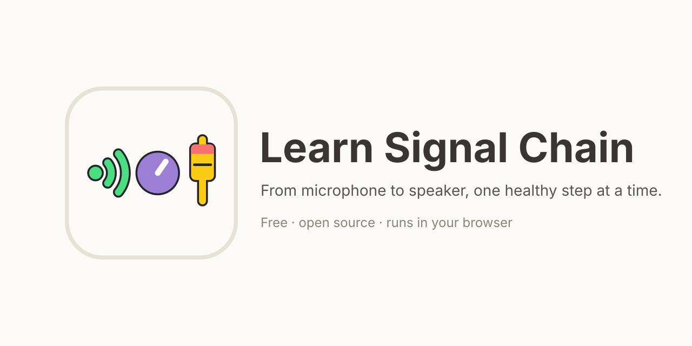
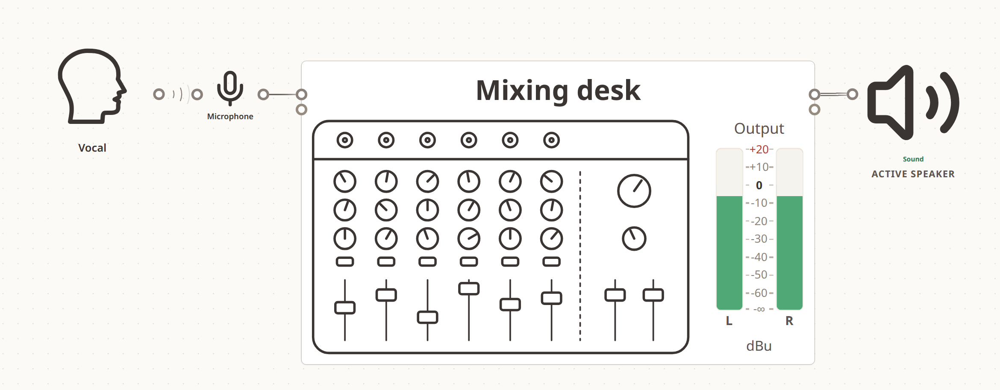
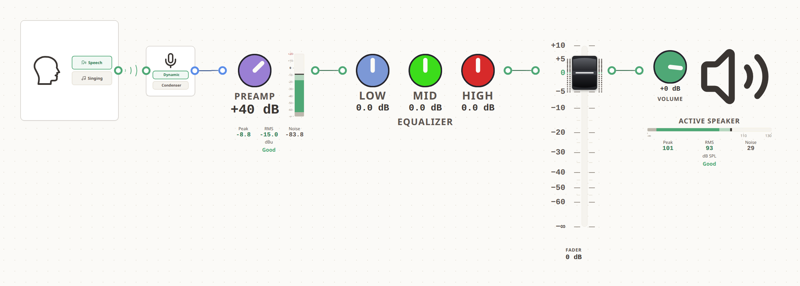
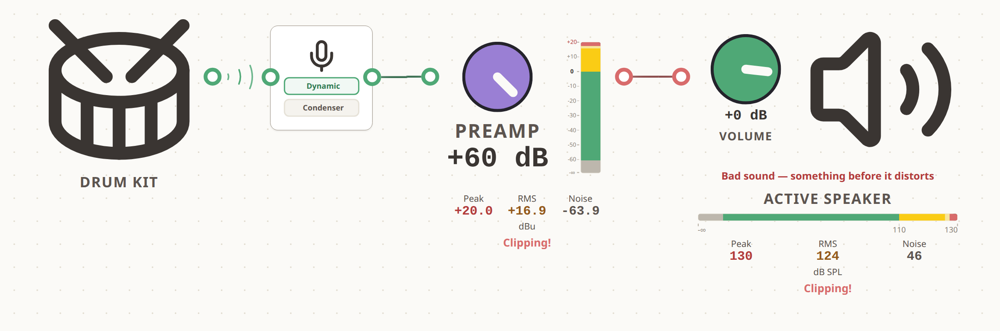
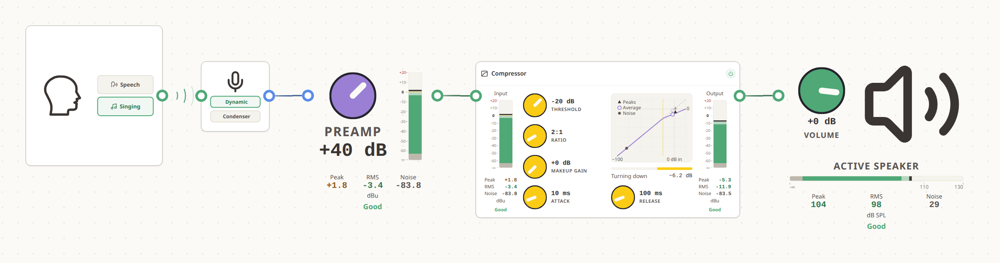
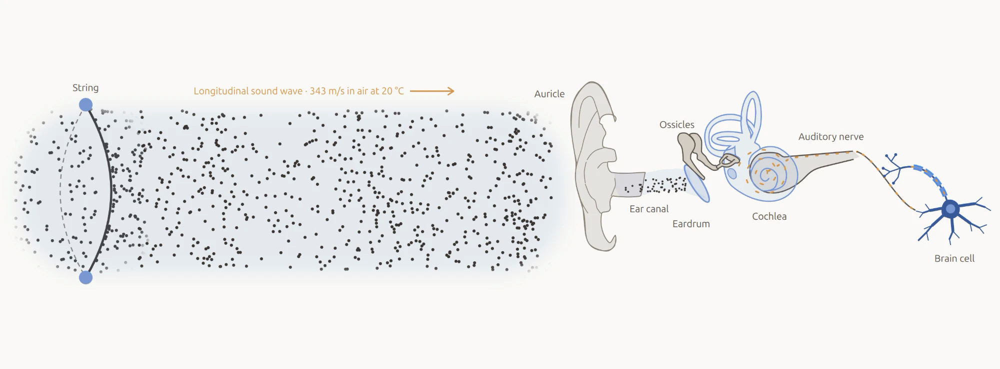

<p align="center">
  
</p>

An interactive, free, open-source web app for teachers and students to explore and understand audio signal chains — from microphone to speaker. Built for people who have never touched a mixing desk.

## Try It Online

No installation needed:

**[https://msvdm.github.io/Learn_Signal-Chain/](https://msvdm.github.io/Learn_Signal-Chain/)**

Runs entirely in your browser. No account, no backend, no cost.

## Use It Offline

- **Download it:** File → *Download the app…* saves the whole app as one `.html` file. Double-click it and it opens in your web browser — no internet, nothing to install. Put it on a USB stick or a shared drive for a class.
- **Or just visit once:** after your first visit, your browser keeps a copy, so the link above opens without internet too. Most browsers also offer to install it as an app (an icon on your desktop or home screen).

## What is it?

Learn Signal Chain lets you drag and connect audio elements on a canvas and watch the signal flow in real time. Every element you add or adjust changes the signal path immediately, and the meters show whether your gain staging is healthy (green), hot (yellow), or clipping (red).

Each of the three levels shows the sound system at its own scale.

**Beginner — the room.** The devices and how they connect: a singer, a microphone, the mixing desk, a speaker. No measured levels yet, only where the sound goes.



**Intermediate — a small desk.** You build the desk's channel yourself, control by control. The Preamp's meter shows how strong the signal is, with its Peak, RMS and Noise, and every connection takes the meters' colour: green is a healthy level.



Turn the Preamp up too far and you see what goes wrong: the meter hits the red, the wire after it turns red, and the speaker says *Bad sound*.



**Advanced — the parts.** The full controls, such as a compressor with its threshold, ratio and a curve showing how much it turns the sound down, its input and output meters side by side.



**Deep dive — why it works.** The fourth button opens a different way of teaching. You can pick a subject and show, step by step, how one thing sets the next in motion — a string moves the air, the air moves the eardrum, a microphone turns the movement into a voltage and a speaker turns it back into sound. Play the movement, or stop it at any point of its cycle. Show how everything is a signal chain and how energy is never created or destroyed — only transformed.



The app does not explain what each element is — that is the teacher's part. It shows what the chain does, as truthfully as it can. Click **?** next to the language button for a short tutorial on how the app works, with example chains to open.

## Privacy

No account, no tracking, no cookies. Everything runs in your browser: the chains you build stay on your computer and are sent nowhere (a share link carries the chain inside the link itself).

## Learning Levels

Each level shows the sound system at its own scale, from the room down to the parts.

| Level | What it shows |
|---|---|
| Beginner — the room | The devices and how they connect: vocal, drum kit, acoustic instrument, microphone, keyboard, computer, Hi-Z instrument (an electric guitar), guitar amp; stage box, mixer, audio interface, DAW; active and passive speakers, amplifier, headphones, studio monitor, recorder, stream / broadcast. No numbers: each output says whether sound reaches it |
| Intermediate — a small desk | You build the desk's channel strip yourself (the mixer and stage box leave): + DI box, phantom power (48V), gain (the preamp after a microphone), high-pass filter, pad, equalizer (three knobs), compressor (one knob), fader, on / off switch, phase switch (the same signal twice on a bus, one upside down: the sound disappears), relay switch, pan / balance, master bus, aux bus, PFL bus; the audio interface and DAW record and play back. On every meter the peaks, the noise and the Peak / RMS / Noise numbers, moving with the sound |
| Advanced — the parts and the digital picture | + signal generator, parametric equalizer, the full compressor, noise gate, limiter, de-esser, graphic equalizer, ADC / DAC, codec (MP3, AAC, Opus), digital interface (AES/EBU, AES50), matrix bus, an effects processor in a rack (somewhere for an aux bus to send — it makes no effect), a delay knob (two copies of one signal a little apart in time stop lining up — with the phase switch, line them up again); the DAW records the tracks wired into it and mixes them (a digital summing bus). Converters choose their sample rate and bit depth, the codec its codec and bitrate, the digital interface its protocol and clock; the computer has an analog and a digital output; Stream / Broadcast sends to a codec that unpacks it, as the listeners receive it, and says how loud it is (LUFS). The recorder, audio interface and studio monitor leave: the converters and the codec take their place |

Switch levels from the header at any time. **Deep dive**, the fourth button, is not a level: it opens the moving pictures described above and keeps your canvas for when you come back.

## Run Locally

```bash
bun install
bun dev        # dev server at http://localhost:5173
bun run build  # production build → dist/
bun test       # tests of the signal maths and the audio processors (without Bun: npm run test:node)
```

(npm/yarn work too if you don't have Bun installed.)

## Tech Stack

- **React + TypeScript** via Vite
- **React Flow** — node-based canvas
- **Zustand** — state management
- **Plain CSS** — the themes as CSS variables in `src/index.css`, inline styles in the components
- **Lucide React** — icons
- **Web Audio API** — the chain played on real sound, measured in an OfflineAudioContext (the sound loops are made by `scripts/make-loops.py`)

## Sources

The noise each element adds — a preamp's noise rising with its gain, every stage's own noise floor, the converters' — follows the published figures of real gear.

Sources for the noise figures:

* [Yamaha MG10XU specs](https://nl.yamaha.com/files/download/other_assets/2/1507032/MG10XU_technical_specifications_En_B0.pdf)
* [Behringer MX1604A specs](https://cf3.zzounds.com/media/MX1604A_B_Specs-3705148b1ccedb25a17d465301e37686.pdf)
* [Sound On Sound: what makes a good mic preamp](https://www.soundonsound.com/sound-advice/q-what-makes-good-mic-preamp)
* [Elliott Sound Products: noise figure](https://sound-au.com/noisefigure.htm)
* [Rane converter specs](https://www.rane.com/jp/seventy-jp)
* [Focusrite Scarlett 8i6 specs](https://userguides.focusrite.com/hc/en-gb/articles/23031453082258-Scarlett-8i6-3rd-Gen-specifications)

Sources for the digital side — what PCM, a file, a codec and a protocol are, how many channels each protocol carries, and why two clocks cause clicks (the Digital Interface, its cable and its Clock):

* [AES3 (AES/EBU) — Wikipedia](https://en.wikipedia.org/wiki/AES3): two channels, up to 24 bits a sample, the clock carried inside the signal
* [Inside the AES3 digital audio standard — TV Technology](https://www.tvtechnology.com/miscellaneous/digital-audio-inside-the-aes32003-digital-audio-standard): subframes, preambles (each packet's header)
* [AES3 — Laboratorio di Informatica Musicale, University of Milan](https://www.lim.di.unimi.it/IEEE/AES/AES3.HTM)
* [AES50 — Wikipedia](https://en.wikipedia.org/wiki/AES50): 48 channels each way at 48 kHz, 24 at 96 kHz, on one Cat5 cable
* [Midas KT-AES50 module](https://www.adorama.com/miktaes50.html) and [Klark Teknik DN9620 AES50 extender](https://www.prosoundweb.com/klark-teknik-announces-new-dn9620-aes50-extender/): the same figures on real gear
* [MADI (AES10) — Wikipedia](https://en.wikipedia.org/wiki/MADI), [ADAT Lightpipe — Wikipedia](https://en.wikipedia.org/wiki/ADAT_Lightpipe), [AES67 — Wikipedia](https://en.wikipedia.org/wiki/AES67), [Audinate: Dante and AES67](https://www.audinate.com/learning/faqs/what-are-the-benefits-of-aes67): the other protocols, for comparison
* [RME ADI-6432 format converter](https://markertek.com/product/rme-adi-6432r/rme-adi-6432r-bidirectional-2x64-channel-madi-aes-3id-format-converter), [RME ADI-648 format converter](https://rme-audio.de/adi-648.html) and [RME's converters](https://rme-audio.de/converter.html): in the trade a "format converter" goes between two protocols (MADI ↔ AES, MADI ↔ ADAT); the numbers pass unchanged
* [Cirrus Logic CS8406](https://mouser.com/datasheet/2/76/CS8406_F6-471719.pdf) ("digital audio interface transmitter") and [CS8416](https://www.alldatasheet.fr/datasheet-pdf/pdf/87567/CIRRUS/CS8416.html) (receiver), [Yamaha MY16-MD64 MADI interface card](https://www.markertek.com/product/ymh-my16md64/yamaha-my16md64-16-channel-madi-interface-card): why the element is called a Digital Interface
* [Allen & Heath Qu-16 manual](https://www.manualslib.com/manual/1273092/Allen-And-Heath-Qu-16.html), [AR2412 stage box](https://andertons.co.uk/allen-heath-ar2412-dsnake-stagebox), [Qu-Drive and USB audio](https://support.allen-heath.com/hc/en-gb/articles/48350897327889-Qu-5-6-7-Qu-Drive-and-USB-audio): a desk's dSNAKE and AES sockets, WAV recording and playback
* [Transloadit: what is an audio codec](https://transloadit.com/blog/2026/01/what-is-an-audio-codec/): PCM as it is, a codec squeezing it
* [Microsoft: USB Audio 2.0 drivers](https://learn.microsoft.com/en-us/windows-hardware/drivers/audio/usb-2-0-audio-drivers): a computer's audio over USB
* [Audient: clocking explained](https://support.audient.com/hc/en-us/articles/202587353), [Mix: digital audio clocks](https://www.mixonline.com/technology/digital-audio-clocks-how-they-work-and-why-you-need-them-383737), [AudioTechnology: word clock explained](https://audiotechnology.com/PDF/14/AT14_Word_Clock_Explained.pdf): one device leads the clock (internal), the others follow it (external); two free-running clocks drift apart and lose samples — clicks and dropouts

Sources for Deep dive's *Analogue amplification* — the XLR's pins, the clean preamp chip and the transformer input:

* [Neutrik: XLR wiring](https://www.neutrik.com/neutrik/faq/xlr): pin 1 the shield, pin 2 hot, pin 3 cold (IEC 60268-12)
* [THAT 1510 / 1512 datasheet](https://www.mouser.com/datasheet/2/407/THAT_1510-1512-Demo_Datasheet-3319.pdf): a mic preamp chip, its gain set by one resistor — 1 + 10 kΩ ÷ RG, 0 to +60 dB
* [Jensen microphone input transformers](https://www.jensen-transformers.com/?p=1036): a 1:10 step-up transformer before the preamp
* [Sound On Sound: unbalanced mics into transformer preamps](https://www.soundonsound.com/sound-advice/q-can-plug-unbalanced-mics-transformer-mic-preamps): pin 3 and the shield
* [Purdue ECE 255: the common-emitter amplifier](https://engineering.purdue.edu/wcchew/ece255f17/ECE%20255%20f17%20latex%20pdf%20files/ece255LectureOct31_rev.pdf): one transistor's gain, the resistor above it over the one below it and its own 26 Ω at 1 mA
* [Sound On Sound: BAE 1073 MPF](https://www.soundonsound.com/reviews/bae-1073-mpf): a classic transformer preamp needs two transistor stages for its +80 dB
* [ProSoundTraining: amplifier sensitivity](https://www.prosoundtraining.com/?p=44890): a power amplifier is a fixed gain behind an input attenuator, its level knob

The ear in Deep dive is adapted from [“Anatomy of the Human Ear”](https://commons.wikimedia.org/wiki/File:Anatomy_of_the_Human_Ear.svg) by Lars Chittka and Axel Brockmann, [CC BY 2.5](https://creativecommons.org/licenses/by/2.5/) — simplified and recoloured.

The guitar's low E in Deep dive (*Complex waves*, the last step) is measured from [FreePats' electric guitar, direct](https://freepats.zenvoid.org/ElectricGuitar/clean-electric-guitar.html) ([CC0](https://creativecommons.org/publicdomain/zero/1.0/)) — a Fender recorded straight into an instrument input, so the ten harmonics are the string's own, with no body and no room over them. A quarter of a second from 60 ms after a soft pluck; rebuilt from those ten, the recording's waveform is within −29 dB.

## Contributing

Contributions of all kinds are welcome — whether that's fixing a bug, adding a new language, suggesting an example chain, or suggesting a feature. There is no "right" level of experience required.

### Adding a Translation

Translations live in `src/i18n/locales/`. Each language is a single JSON file with no TypeScript required.

**To add a new language:**

1. Copy `src/i18n/locales/en.json` to `src/i18n/locales/{lang-code}.json`  
   (e.g. `fr.json`, `de.json`, `es.json` — use [BCP 47](https://en.wikipedia.org/wiki/IETF_language_tag) codes)
2. Translate all the string values. Keep the keys exactly as they are.
3. Open `src/i18n/locales/index.ts` and add one line:
   ```ts
   import fr from './fr.json'
   // then in LOCALES (the build fails if a key is missing):
   fr: { nativeName: 'Français', translations: fr satisfies LocaleStrings },
   ```
4. Open a pull request.

The app already has English and Bulgarian. All other languages are open and very welcome.

**Improving an existing translation:**  
Edit the relevant `.json` file directly and open a PR. If you spot something unnatural or technically wrong, please fix it — native speakers know best.

### Other Ways to Contribute

- **Fix a bug** — open an issue or a PR
- **Report something the app gets wrong** — a level, a meter or a note that does not match real equipment; the app must never mislead a class
- **Report a confusing UI** — especially welcome since the app targets complete beginners
- **Suggest a feature** — open an issue; ideas for future additions include a frequency spectrum analyser and reverb/delay nodes

### About This Project

This app was built with [Claude Code](https://claude.ai/code) by Anthropic. All help — translations, fixes, ideas, feedback — is more than welcome.

## License

MIT — see [LICENSE](LICENSE).
