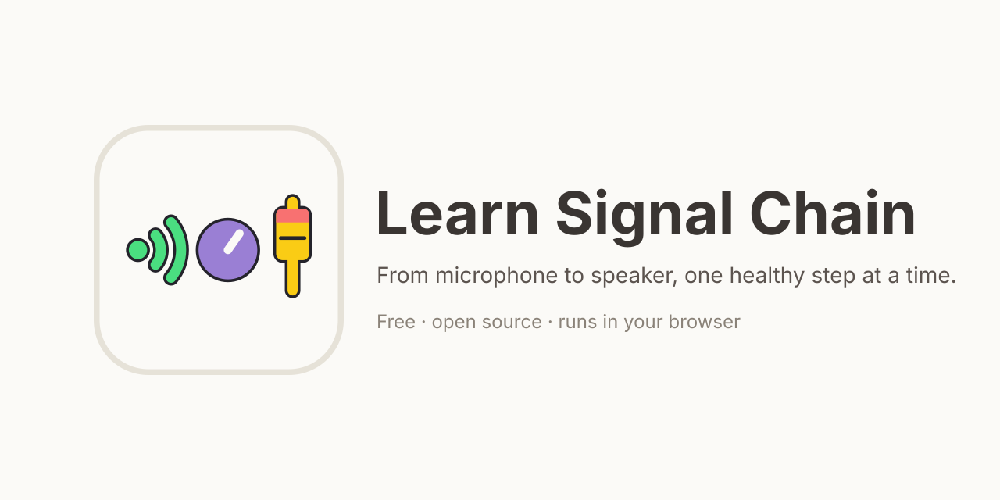
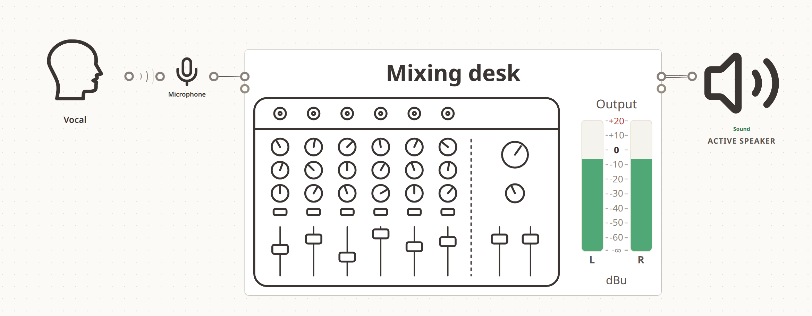
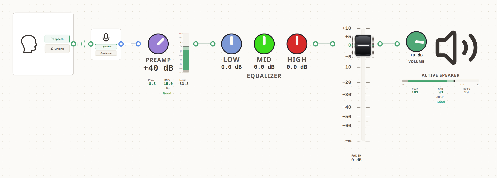
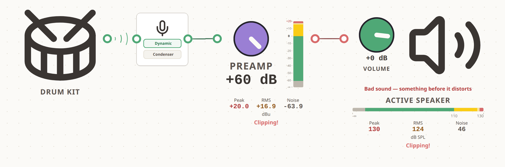
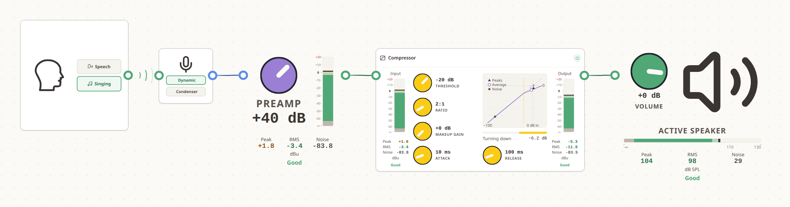

<p align="center">
  
</p>

An interactive, free, open-source web app for teachers and students to explore and understand audio signal chains — from microphone to speaker. Built for people who have never touched a mixing desk.

## Try It Online

No installation needed:

**[https://msvdm.github.io/Learn_Signal-Chain/](https://msvdm.github.io/Learn_Signal-Chain/)**

Runs entirely in your browser. No account, no backend, no cost.

## Use It Offline

- **Download it:** File → *Download the app…* saves the whole app as one `.html` file. Double-click it and it opens in your web browser — no internet, nothing to install. Put it on a USB stick or a shared drive for a class.
- **Or just visit once:** after your first visit, your browser keeps a copy, so the link above opens without internet too. Most browsers also offer to install it as an app (an icon on your desktop or home screen).

## What is it?

Learn Signal Chain lets you drag and connect audio elements on a canvas and watch the signal flow in real time. Every element you add or adjust changes the signal path immediately, and the meters show whether your gain staging is healthy (green), hot (yellow), or clipping (red).

Each of the three levels shows the sound system at its own scale.

**Beginner — the room.** The devices and how they connect: a singer, a microphone, the mixing desk, a speaker. No measured levels yet, only where the sound goes.



**Intermediate — a small desk.** You build the desk's channel yourself, control by control. The Preamp's meter shows how strong the signal is, with its Peak, RMS and Noise, and every connection takes the meters' colour: green is a healthy level.



Turn the Preamp up too far and you see what goes wrong: the meter hits the red, the wire after it turns red, and the speaker says *Bad sound*.



**Advanced — the parts.** The full controls, such as a compressor with its threshold, ratio and a curve showing how much it turns the sound down, its input and output meters side by side.



The app does not explain what each element is — that is the teacher's part. It shows what the chain does, as truthfully as it can. Click **?** next to the language button for a short tutorial on how the app works, with example chains to open.

## Features

- **Three levels, three scales.** *Beginner* shows the devices in a room and how they connect — no numbers: every speaker, recorder or stream simply says whether sound reaches it. *Intermediate* opens up the channel strip of a small mixing desk, control by control. *Advanced* shows the full controls and the digital side.
- **The numbers come from real sound.** Every source plays a short loop made for the app — a speaking voice, a singing voice, drums, a guitar, music — and the whole chain is played silently in your browser and measured element by element: real filters, a real compressor, noise gate, limiter and de-esser. Nothing is heard, and nothing leaves your computer.
- **Meters like a recording program's.** Coloured along their scale (green, yellow as it gets hot, red at the very top), the solid bar the average, a pale part the peaks, a thin line the loudest moment. From Intermediate on they move with the sound, with their Peak, RMS and Noise numbers; the grey part at the bottom is the noise — what you hear when the music stops.
- **Clipping comes from the peaks.** A drum hit distorts long before its average reaches the top: the element turns red as soon as its loudest moments clip, and a speaker after it says *Bad sound*, however green the meters in between.
- **Noise like a real mixing desk.** Every powered element adds a little noise of its own, at the levels real gear has (see *Sources* below). Set the preamp too low and make the level up later, and the speaker ends up noisier — that is why the gain is set at the preamp.
- **The microphone is not the sound.** A singer, a drum kit, an acoustic instrument or a guitar amp makes sound in the air, drawn as waves spreading to the microphone. A condenser microphone gives more signal than a dynamic one, but stays silent until Phantom Power (48V) is switched on before its Preamp.
- **Wires show their signal's health**, like the meters: blue too quiet, green good, yellow hot, red clipping, grey with no signal. Each kind of connection looks different: sound in the air as waves, an analog cable a line with light flowing along it, a digital one dots and dashes, a stereo one two lines side by side.
- **It says what is wrong**, in plain words under the element: a speaker fed a digital signal, a passive speaker with no amplifier, a condenser microphone without 48V, an element with nothing plugged in.
- **Build the desk yourself:** Gain / Preamp (with its meter), 48V, high-pass filter, pad, equalizer, compressor, fader, on / off switch, relay switch, pan, and the Master, Aux, Matrix and PFL buses. The first fader after a bus is its main fader. One stereo wire carries both sides everywhere; wired to speakers, an output turns into L and R, one speaker each.
- **Record and play back:** an Audio Interface and a DAW (a recording program on a computer), joined by one USB wire that carries the sound both ways. *Look inside* shows what the boxes hold.
- **The digital side**, at Advanced: converters with their sample rate and bit depth (a 16-bit converter's noise floor is real), a codec squeezing the mix into MP3, AAC or Opus, a Digital Interface packing the numbers into an AES/EBU or AES50 cable — with its clock —, a DAW recording and mixing tracks, and a live stream sent and received again, with its loudness in LUFS. Four different things side by side: the numbers (PCM), a file that keeps them (WAV), a codec that squeezes them (MP3), a protocol that carries them (AES/EBU, AES50).
- **Save and share:** your chain is kept in the browser as you work; save it as a file or as a picture with the chain inside, or send a link that opens it.
- **A short tutorial** on how the app works (the **?** button), with example chains to open and change.
- **English and Bulgarian**, light and dark themes, and it works offline (see above).

## Privacy

No account, no tracking, no cookies. Everything runs in your browser: the chains you build stay on your computer and are sent nowhere (a share link carries the chain inside the link itself).

## Learning Levels

Each level shows the sound system at its own scale, from the room down to the parts.

| Level | What it shows |
|---|---|
| Beginner — the room | The devices and how they connect: vocal, drum kit, acoustic instrument, microphone, keyboard, computer, Hi-Z instrument (an electric guitar), guitar amp; stage box, mixer, audio interface, DAW; active and passive speakers, amplifier, headphones, studio monitor, recorder, stream / broadcast. No numbers: each output says whether sound reaches it |
| Intermediate — a small desk | You build the desk's channel strip yourself (the mixer and stage box leave): + DI box, phantom power (48V), gain (the preamp after a microphone), high-pass filter, pad, equalizer (three knobs), compressor (one knob), fader, on / off switch, relay switch, pan / balance, master bus, aux bus, PFL bus; the audio interface and DAW record and play back. On every meter the peaks, the noise and the Peak / RMS / Noise numbers, moving with the sound |
| Advanced — the parts and the digital picture | + signal generator, parametric equalizer, the full compressor, noise gate, limiter, de-esser, graphic equalizer, ADC / DAC, codec (MP3, AAC, Opus), digital interface (AES/EBU, AES50), matrix bus, an effects processor in a rack (somewhere for an aux bus to send — it makes no effect), a phase switch and a delay knob (two copies of one signal cancel out, or stop lining up); the DAW records the tracks wired into it and mixes them (a digital summing bus). Converters choose their sample rate and bit depth, the codec its codec and bitrate, the digital interface its protocol and clock; the computer has an analog and a digital output; Stream / Broadcast sends to a codec that unpacks it, as the listeners receive it, and says how loud it is (LUFS). The recorder, audio interface and studio monitor leave: the converters and the codec take their place |

Switch levels from the header at any time.

## Run Locally

```bash
bun install
bun dev        # dev server at http://localhost:5173
bun run build  # production build → dist/
bun test       # tests of the signal maths and the audio processors (without Bun: npm run test:node)
```

(npm/yarn work too if you don't have Bun installed.)

## Tech Stack

- **React + TypeScript** via Vite
- **React Flow** — node-based canvas
- **Zustand** — state management
- **Plain CSS** — the themes as CSS variables in `src/index.css`, inline styles in the components
- **Lucide React** — icons
- **Web Audio API** — the chain played on real sound, measured in an OfflineAudioContext (the sound loops are made by `scripts/make-loops.py`)

## Sources

The noise each element adds — a preamp's noise rising with its gain, every stage's own noise floor, the converters' — follows the published figures of real gear.

Sources for the noise figures:

* [Yamaha MG10XU specs](https://nl.yamaha.com/files/download/other_assets/2/1507032/MG10XU_technical_specifications_En_B0.pdf)
* [Behringer MX1604A specs](https://cf3.zzounds.com/media/MX1604A_B_Specs-3705148b1ccedb25a17d465301e37686.pdf)
* [Sound On Sound: what makes a good mic preamp](https://www.soundonsound.com/sound-advice/q-what-makes-good-mic-preamp)
* [Elliott Sound Products: noise figure](https://sound-au.com/noisefigure.htm)
* [Rane converter specs](https://www.rane.com/jp/seventy-jp)
* [Focusrite Scarlett 8i6 specs](https://userguides.focusrite.com/hc/en-gb/articles/23031453082258-Scarlett-8i6-3rd-Gen-specifications)

Sources for the digital side — what PCM, a file, a codec and a protocol are, how many channels each protocol carries, and why two clocks cause clicks (the Digital Interface, its cable and its Clock):

* [AES3 (AES/EBU) — Wikipedia](https://en.wikipedia.org/wiki/AES3): two channels, up to 24 bits a sample, the clock carried inside the signal
* [Inside the AES3 digital audio standard — TV Technology](https://www.tvtechnology.com/miscellaneous/digital-audio-inside-the-aes32003-digital-audio-standard): subframes, preambles (each packet's header)
* [AES3 — Laboratorio di Informatica Musicale, University of Milan](https://www.lim.di.unimi.it/IEEE/AES/AES3.HTM)
* [AES50 — Wikipedia](https://en.wikipedia.org/wiki/AES50): 48 channels each way at 48 kHz, 24 at 96 kHz, on one Cat5 cable
* [Midas KT-AES50 module](https://www.adorama.com/miktaes50.html) and [Klark Teknik DN9620 AES50 extender](https://www.prosoundweb.com/klark-teknik-announces-new-dn9620-aes50-extender/): the same figures on real gear
* [MADI (AES10) — Wikipedia](https://en.wikipedia.org/wiki/MADI), [ADAT Lightpipe — Wikipedia](https://en.wikipedia.org/wiki/ADAT_Lightpipe), [AES67 — Wikipedia](https://en.wikipedia.org/wiki/AES67), [Audinate: Dante and AES67](https://www.audinate.com/learning/faqs/what-are-the-benefits-of-aes67): the other protocols, for comparison
* [RME ADI-6432 format converter](https://markertek.com/product/rme-adi-6432r/rme-adi-6432r-bidirectional-2x64-channel-madi-aes-3id-format-converter), [RME ADI-648 format converter](https://rme-audio.de/adi-648.html) and [RME's converters](https://rme-audio.de/converter.html): in the trade a "format converter" goes between two protocols (MADI ↔ AES, MADI ↔ ADAT); the numbers pass unchanged
* [Cirrus Logic CS8406](https://mouser.com/datasheet/2/76/CS8406_F6-471719.pdf) ("digital audio interface transmitter") and [CS8416](https://www.alldatasheet.fr/datasheet-pdf/pdf/87567/CIRRUS/CS8416.html) (receiver), [Yamaha MY16-MD64 MADI interface card](https://www.markertek.com/product/ymh-my16md64/yamaha-my16md64-16-channel-madi-interface-card): why the element is called a Digital Interface
* [Allen & Heath Qu-16 manual](https://www.manualslib.com/manual/1273092/Allen-And-Heath-Qu-16.html), [AR2412 stage box](https://andertons.co.uk/allen-heath-ar2412-dsnake-stagebox), [Qu-Drive and USB audio](https://support.allen-heath.com/hc/en-gb/articles/48350897327889-Qu-5-6-7-Qu-Drive-and-USB-audio): a desk's dSNAKE and AES sockets, WAV recording and playback
* [Transloadit: what is an audio codec](https://transloadit.com/blog/2026/01/what-is-an-audio-codec/): PCM as it is, a codec squeezing it
* [Microsoft: USB Audio 2.0 drivers](https://learn.microsoft.com/en-us/windows-hardware/drivers/audio/usb-2-0-audio-drivers): a computer's audio over USB
* [Audient: clocking explained](https://support.audient.com/hc/en-us/articles/202587353), [Mix: digital audio clocks](https://www.mixonline.com/technology/digital-audio-clocks-how-they-work-and-why-you-need-them-383737), [AudioTechnology: word clock explained](https://audiotechnology.com/PDF/14/AT14_Word_Clock_Explained.pdf): one device leads the clock (internal), the others follow it (external); two free-running clocks drift apart and lose samples — clicks and dropouts

## Contributing

Contributions of all kinds are welcome — whether that's fixing a bug, adding a new language, suggesting an example chain, or suggesting a feature. There is no "right" level of experience required.

### Adding a Translation

Translations live in `src/i18n/locales/`. Each language is a single JSON file with no TypeScript required.

**To add a new language:**

1. Copy `src/i18n/locales/en.json` to `src/i18n/locales/{lang-code}.json`  
   (e.g. `fr.json`, `de.json`, `es.json` — use [BCP 47](https://en.wikipedia.org/wiki/IETF_language_tag) codes)
2. Translate all the string values. Keep the keys exactly as they are.
3. Open `src/i18n/locales/index.ts` and add one line:
   ```ts
   import fr from './fr.json'
   // then in LOCALES (the build fails if a key is missing):
   fr: { nativeName: 'Français', translations: fr satisfies LocaleStrings },
   ```
4. Open a pull request.

The app already has English and Bulgarian. All other languages are open and very welcome.

**Improving an existing translation:**  
Edit the relevant `.json` file directly and open a PR. If you spot something unnatural or technically wrong, please fix it — native speakers know best.

### Other Ways to Contribute

- **Fix a bug** — open an issue or a PR
- **Report something the app gets wrong** — a level, a meter or a note that does not match real equipment; the app must never mislead a class
- **Report a confusing UI** — especially welcome since the app targets complete beginners
- **Suggest a feature** — open an issue; ideas for future additions include a frequency spectrum analyser and reverb/delay nodes

### About This Project

This app was built with [Claude Code](https://claude.ai/code) by Anthropic. All help — translations, fixes, ideas, feedback — is more than welcome.

## License

MIT — see [LICENSE](LICENSE).
