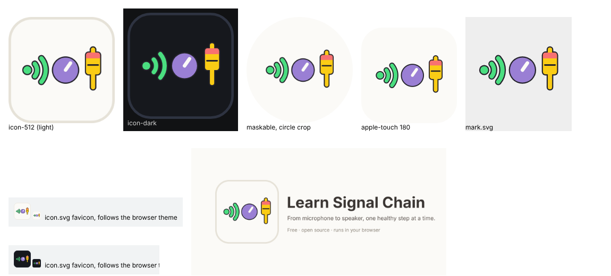

# New logo: implementation brief for Claude Code

Marian chose the logo on 2026-10-31. The mark is the signal chain in three objects: **sound arrives** (a green wave), **a hand sets the level** (a purple knob), and **the result leaves through a fader** (a yellow cap with a red top, meaning too hot). It replaces the broadcast-waves icon (lucide `Radio`) everywhere.



Everything comes from **one script**, `make-icons.py`. The geometry and colours live there, and every SVG, PNG and the React component are generated from it. Don't hand-edit the outputs; change the script and run it again.

## What is in this folder

| File | What it is |
| --- | --- |
| `IMPLEMENTATION.md` | This brief |
| `make-icons.py` | The generator. **Move it to `scripts/make-icons.py`** next to `make-loops.py` |
| `preview.png` | What the outputs look like (for review only; delete after implementing if you like) |
| `mark.svg` | The mark alone on a transparent background |
| `icon-light.svg`, `icon-dark.svg` | The mark on the light or dark tile, with the keyline (used by README) |
| `icon-maskable.svg` | Full-bleed tile with the mark inside the central 80 % circle |
| `social-preview.png` | 1280 × 640 for GitHub → Settings → Social preview (Marian uploads it by hand) |
| `png/` | Pre-rendered `icon-192.png`, `icon-512.png`, `icon-maskable-512.png`, `apple-touch-icon.png`. A fallback, in case the script can't render PNGs on this machine |

## Steps

1. **Move the generator:** `git mv docs/brand/make-icons.py scripts/make-icons.py`
2. **Run it** from the repository root: `python3 scripts/make-icons.py`. It writes:
   - `public/icon.svg`: the favicon and the manifest's `any` icon. **One file that follows the browser's light/dark theme** (an `@media (prefers-color-scheme: dark)` rule inside the SVG). `vite-offline.ts` already inlines `public/icon.svg` as a data URI, so the downloaded single-file app gets it too.
   - `public/icon-192.png`, `public/icon-512.png`, `public/icon-maskable-512.png`, `public/apple-touch-icon.png`: same file names as today, so `index.html` and `public/manifest.webmanifest` need **no changes**.
   - `docs/brand/mark.svg`, `icon-light.svg`, `icon-dark.svg`, `icon-maskable.svg`, `social-preview.png`
   - `src/components/AppLogo.tsx`: the header logo (see step 3)

   PNGs need `rsvg-convert` (Debian/Mint: `sudo apt install librsvg2-bin`) or `pip install cairosvg`. Without either, the script writes the SVGs and skips the PNGs; then copy the four files from `docs/brand/png/` into `public/` (they are byte-identical to what the script makes) and delete `docs/brand/png/` afterwards either way.
3. **The header** (`src/App.tsx`, the brand block left of the title, about lines 98–107): replace the 32 × 32 chip, a `div` with `background: var(--signal-good-bg)` holding `<Radio size={17} />`, with

   ```tsx
   <AppLogo size={32} />
   ```

   and `import { AppLogo } from './components/AppLogo'`. Remove `Radio` from the `lucide-react` import if nothing else uses it (grep `src/` for `Radio` first). `AppLogo` draws its own tile with `var(--lsc-canvas)` and keeps a `var(--lsc-border)` keyline, so it follows the app's own theme switch, not just the browser's. The mark's colours never change.
4. **README:** replace the first line `# Learn Signal Chain` with the centred logo block below. GitHub shows the dark tile to readers in dark mode:

   ```html
   <p align="center">
     <picture>
       <source media="(prefers-color-scheme: dark)" srcset="docs/brand/icon-dark.svg">
       
     </picture>
   </p>

   <h1 align="center">Learn Signal Chain</h1>

   <p align="center"><b>From microphone to speaker.</b> A free web app for teachers and students to build an audio signal chain and watch the level at every step.</p>
   ```

   Keep the existing first paragraph below it, or drop it if it now repeats the tagline. Leave that to taste, in the README's own voice. Add one line to the next **What's New** section, for example *"A new logo: a sound wave, a knob and a fader. The signal chain in three steps."*
5. **Decision log:** add the next `D` entry to `docs/decisions.md`. It should say that the logo is the wave → knob → fader mark, made by `scripts/make-icons.py`, with the same colours in both themes and only the tile following the theme. Also add `scripts/make-icons.py` to CLAUDE.md where `make-loops.py` is listed, for example: *"Remaking the icons (`python3 scripts/make-icons.py`) needs Python 3 and `rsvg-convert` or `cairosvg`."*
6. **Service worker:** the icons keep their file names and aren't hashed. Check that `vite-offline.ts`'s cached copy of the public files is refreshed on the next build (it caches "scripts, styles, icons"), so installed apps pick up the new icon rather than serving the old one from cache. If the cache key is only build-hash based, that is enough.
7. **Check:** `bun run lint`, `bun test`, `bun run build`. Then `bun run preview` and look at:
   - the browser tab icon in a light and a dark browser theme
   - the header logo in the app's Light and Dark themes
   - `dist/learn-signal-chain.html` (the offline file) showing the new favicon
   - Chrome DevTools → Application → Manifest showing the four icons, with the maskable one inside the safe circle.

## The design, for reference

- **Colours, identical in both themes:** wave `#4ade80` · knob `#9a7fd4` (the app's button purple) · fader `#facc15` with a `#f87171` top · a thin `#24232b` outline round every shape, which keeps the green and yellow readable on the light tile · knob pointer `#fbfaf7`.
- **Tiles:** light `#fbfaf7` with keyline `#e6e2d8`; dark `#16181d` with keyline `#2e3341`. These are the app's canvas and card-border colours. In the header, `AppLogo` uses `var(--lsc-canvas)` and `var(--lsc-border)` instead.
- **Geometry** (512 × 512 canvas): tile radius 112, keyline 12 inset 6. The mark is 381 wide (x 66 → 447) and centred on the tile. Maskable: full-bleed square, mark at 86 %. Apple touch: full-bleed square, mark at 94 % (iOS rounds the corners itself).
- **Fader:** smaller and closer to the knob than in the first draft, as Marian set it: track x 407, y 157 → 339; cap 68 × 105, top at y 171.

Design history (all rounds, every option) is in the "Learn Signal Chain" design system on claude.ai.
